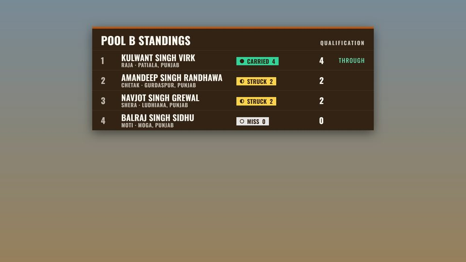

<!--
EDITING NOTES (not printed, and not shown on GitHub)

This handout is also the source of public/documents/vmix-guide.pdf. After
editing it, run `npm run build:guide` and commit both this file and the PDF.
The formatting rules are the staff guide's, described at the top of
docs/superpowers/plans/2026-10-25-staff-guide-outline.md. In short:

- The paragraph before the first `#` heading is the summary on the PDF's cover.
- `# Label — subtitle` starts a new page with a tab on the page edge and an
  entry in the cover's list. `##` and `###` are headings inside a section.
- `>` lines are a highlighted box, `|` lines a table, `1.` numbered steps,
  `-` bullets. Text in backticks prints as code; an address in backticks is
  also a link. Keep every address exactly as the feeds serve it.
- A paragraph ending with a colon stays on the same page as what follows it.
- Pictures are named relative to this folder, so GitHub shows them too.
- The site title and the contact email come from src/lib/site.ts.
- Only characters the PDF's built-in fonts carry: no arrows (write ›).
- Plain English, button and menu names exactly as on screen. Never name any
  organisation, club or sponsor.
-->

During the {site.title}, the website publishes the live scoring as **four public data feeds** that vMix reads directly as Data Sources. Each feed is a list of **flat rows**, in JSON or CSV. **Every column is always present**, so a binding cannot break, and a feed sends **one row of empty values** when there is nothing to show. Set each Data Source to refresh every **1–2 seconds** and your titles follow every judge's result within a second or two.

# The four feeds — addresses, options and an example

## What it is

The championship website publishes live scoring as four data feeds that vMix can read directly as **Data Sources**. Every time a judge records a result (Carried 4, Struck 2 or Miss 0), the feeds change. At a refresh of 1–2 seconds your titles follow within a second or two.

Each feed is a **JSON array of flat rows**, or **CSV** with a header row if you add `?format=csv`. **Every column is present on every response**, as text or a number, never missing and never null, so a binding cannot break. When there is nothing to show (before the event, between rounds, an unknown pool or round), a feed returns **one row of empty values**.

> **The feeds are public and need no login or key.** They carry only what is announced over the PA: rider and team names, horses, district and state, pools, results and standings. Nothing private.

## Addresses

| Feed | Address |
| --- | --- |
| Current | `https://www.nezabazipunjab.com/api/live/vmix/current` |
| Leaderboard | `https://www.nezabazipunjab.com/api/live/vmix/leaderboard` |
| Entrants | `https://www.nezabazipunjab.com/api/live/vmix/entrants` |
| Rounds | `https://www.nezabazipunjab.com/api/live/vmix/rounds` |

### The rows each feed sends

- **Current:** one row: the round, the pool, the rider on course, the attempt, the screens' mode and message, and the last result.
- **Leaderboard:** one row per entrant in the live round, ranked.
- **Entrants:** one row per entrant in start order: the start list, with each entrant's progress.
- **Rounds:** one row per round of the day, in running order.

## Options

Add options after `?`, and join several with `&`:

| Option | Works on | Effect |
| --- | --- | --- |
| `format=csv` | all four | CSV with a header row instead of JSON |
| `sample=1` | all four | Fixed rehearsal data instead of live data (see Rehearsal, under Setting up) |
| `sample=solo` | all four | Moving rehearsal data: a scripted solo competition that changes every 8 seconds, while the organisers have it running (see Rehearsal, under Setting up) |
| `pool=A` | leaderboard | Only Pool A, ranked within the pool |
| `limit=10` | leaderboard | At most 10 rows (default 50, maximum 200) |
| `round=<round_id>` | entrants | Another round than the live one; take the `round_id` from the rounds feed |

For example, the leaderboard of Pool B, at most 10 rows, as CSV:

> `https://www.nezabazipunjab.com/api/live/vmix/leaderboard?pool=B&limit=10&format=csv`

# Setting up — Data Sources in vMix, and rehearsal

## Adding a feed in vMix

1. **Settings › Data Sources › Add › JSON** (or **CSV** if you used `?format=csv`).
2. Paste the address and set the refresh to every **1–2 seconds**. The website caches each feed for one second, so refreshing faster gains nothing.
3. In the **GT Title Designer**, bind each text field to a column.
4. For the feeds with many rows (leaderboard, entrants, rounds), use the Data Source row controls on the title input to step through the rows.

## Rehearsal with ?sample=1

The live feeds stay empty until event day. Add `?sample=1` to any feed to build and test titles now. Sample data never touches the live database and is the same on every refresh. It holds two rounds:

- a Single **Qualification** round, live, in Pools A and B: Pool A has finished, Pool B is on its second pass with a rider on course, and the message reads "Sample data for rehearsal — not real results";
- a completed **Section 1** round with two teams of four riders.

The rounds feed lists both. For the Section round's entrants, with their four riders in `members`, use this address:

> `https://www.nezabazipunjab.com/api/live/vmix/entrants?sample=1&round=5a3b1e00-0000-4000-8000-000000000002`

Every sample row has `sample` = `Yes`; live rows have `No`.

## Moving rehearsal with ?sample=solo

`?sample=1` never changes, so it cannot show how your titles behave when results come in. Add `?sample=solo` instead, to any feed, and while the organisers have the rehearsal feed running the feeds play a **scripted solo qualification on a loop**, one step every **8 seconds**, about four minutes per loop:

1. Pool A is called (`display_mode` = `pool_call`), and its first rider comes on course.
2. Results come in one by one. A carry skips that rider's later attempts, as on the day, and the standings re-rank.
3. A result is recorded wrongly and then changed, and a short break shows a message.
4. Pool A finishes and the screens switch to the standings, then Pool B is called.
5. In Pool B, a result is recorded and then undone, which puts that rider back on course, and one run is skipped.
6. The qualification finishes: standings, a closing message, a blank screen, and the loop starts again.

It follows the same rules as real scoring and uses the same columns, options and timing (a 1–2 second refresh). The only difference is that nobody is scoring: the steps come from a script, at a steady pace. Real judging has pauses and bursts.

- Every viewer sees the same moment of the loop, with real times in `last_scored_at` and `updated_at`.
- Every row still has `sample` = `Yes`. Nothing is read from or written to the live database.
- Section 1 stays complete, as in `?sample=1`.

> **Ask us to start it.** The organisers start and stop the rehearsal feed from the website. While it is stopped, `?sample=solo` answers exactly like `?sample=1`: frozen, and still marked `sample` = `Yes`. To check whether it is running, open `https://www.nezabazipunjab.com/overlay` and look for "Moving sample right now", or open a `?sample=solo` address twice, ten seconds apart: if it is running, the answers differ. A start or stop reaches the feeds within a second or two.

> **Bind a "SAMPLE" badge to the `sample` column**, so rehearsal data can never go to air unnoticed. **Remove `?sample=1` and `?sample=solo` from every Data Source before the event.**

# Screens — what the organisers want on screen

## What to show: display_mode

The judges and organisers choose what the screens show, and the current feed reports it in `display_mode`. The feeds themselves are never filtered, so honouring it is up to your titles:

| `display_mode` | Meaning |
| --- | --- |
| `scoreboard` | Normal: the rider on course, results, standings |
| `leaderboard` | Standings take the screen; hide the rider graphics |
| `rider` | The rider on course alone; hide the standings |
| `pool_call` | A pool is being called to the start ("Pool B — get ready"): show that pool's riders, e.g. from the entrants feed by `pool_label`. The first result switches back to `scoreboard` |
| `message` | Show only the `message` text |
| `blank` | Hide every graphic (breaks, ceremonies) |

The ready-made overlays (see Extras) follow `display_mode` by themselves.

## The announcement: message

`message` can be set in any mode: up to 200 characters of announcement text.

# Columns — what every column means

Every row has all of its feed's columns, in the order below, and ends with `sample`.

## Current — one row

| Column | Meaning |
| --- | --- |
| `round_name` | Name of the live round, e.g. "Qualification" |
| `event_type` | `single` (one rider) or `section` (teams of four) |
| `round_number` | 0 for the qualification, then 1, 2, … |
| `pool_label` | The pool called to the start — normally the one riding now |
| `next_pool_label` | The pool after it; empty after the last pool |
| `rider_name` | Rider on course; empty when nobody is |
| `team_name` | Their team (Section only) |
| `horse_name` | Their horse |
| `location_short` | District and state, e.g. "Jalandhar, Punjab" |
| `attempt_number` | This rider's attempt in the round |
| `attempts_per_rider` | 3 in the qualification, otherwise 1 |
| `run_order` | Position of this run in the start list |
| `runs_total` | Number of runs in the round's start list |
| `display_mode` | What the organisers want on screen (see Screens) |
| `message` | Announcement text, when one is set |
| `last_rider_name` | Rider of the most recent result |
| `last_team_name` | Their team |
| `last_result` | `Carried`, `Struck` or `Miss` |
| `last_points` | 4, 2 or 0 |
| `last_scored_at` | Time of that result (ISO 8601, UTC; Amritsar is UTC+5:30) |
| `updated_at` | When the live position last changed (ISO 8601, UTC) |
| `sample` | `Yes` for rehearsal data, `No` for live data |

## Leaderboard — one row per entrant, ranked

| Column | Meaning |
| --- | --- |
| `rank` | Rank in the whole round |
| `pool_rank` | Rank within the pool |
| `pool_label` | The entrant's pool |
| `name` | Rider (Single) or team (Section) |
| `team_name` | Team name (Section) |
| `horse_name` | Horse (Single only) |
| `location_short` | District and state |
| `points` | Single: best run. Section: the four riders' runs added up |
| `best_result` | `Carried`, `Struck` or `Miss` |
| `runs_scored` | Runs with a result |
| `runs_total` | Runs to ride, not counting skipped ones |
| `advanced` | `Yes` (through), `No` (out), or empty while undecided |
| `sample` | `Yes` for rehearsal data, `No` for live data |

## Entrants — one row per entrant, in start order

| Column | Meaning |
| --- | --- |
| `entrant_key` | Stable id of the rider or team in this event |
| `pool_label` | Their pool |
| `start_position` | Start-list position of their first run (rows are in this order) |
| `name` | Rider (Single) or team (Section) |
| `team_name` | Team name (Section) |
| `horse_name` | Horse (Single only) |
| `location_short` | District and state |
| `members` | Section: the four riders in riding order, separated by `; ` |
| `runs_total` | Runs to ride, not counting skipped ones |
| `runs_scored` | Runs with a result |
| `points` | Points so far |
| `best_result` | `Carried`, `Struck` or `Miss` |
| `advanced` | `Yes`, `No`, or empty while undecided |
| `rank` | Rank in the round |
| `pool_rank` | Rank within the pool |
| `sample` | `Yes` for rehearsal data, `No` for live data |

## Rounds — one row per round, in running order

| Column | Meaning |
| --- | --- |
| `round_id` | The id that `entrants?round=` takes |
| `name` | Round name |
| `event_type` | `single` or `section` |
| `round_number` | 0, 1, 2, … |
| `status` | `upcoming`, `live` or `complete` |
| `is_live` | `Yes` for the round being ridden now |
| `attempts_per_rider` | 3 in the qualification, otherwise 1 |
| `target_points` | Section: points a team needs to go through (8, 12, 16); 0 for Single |
| `pool_size` | Planned entrants per pool; 0 when the round has no pools |
| `pool_count` | Pools drawn |
| `entrants` | Riders (Single) or teams (Section) in the start list |
| `runs_total` | Runs to ride, not counting skipped ones |
| `runs_scored` | Runs with a result |
| `sample` | `Yes` for rehearsal data, `No` for live data |

# Extras — the bridge script and ready-made overlays

Both are optional: the Data Sources above are all a title needs.

## Optional: the bridge script

If you would rather have values pushed into an existing title than bind Data Source columns, there is a small script that reads the current feed every second and sends each changed value into a vMix title through vMix's own local API (`SetText`). It needs Node.js 24 on the computer that runs it, with no other installation; ask us for the file (`vmix-bridge.mjs`). Run it on the vMix computer, for example:

> `node vmix-bridge.mjs --input "Scorebug" --only rider_name,team_name,last_result --map rider_name=Name`

- That sends `rider_name` to the title field `Name`, and so on.
- `--sample` uses the rehearsal data, `--moving-sample` the moving rehearsal data, and `--dry-run --once` prints what it would send without touching vMix.
- It retries by itself when the network or vMix drops, and sends everything again when vMix comes back.
- `--help` lists every option.
- It handles the one-row current feed only.

## Optional: ready-made overlays

If you prefer finished graphics in the website's style, five transparent overlay pages can be added as vMix **Web Browser** inputs (1920×1080, on an overlay channel, one input per overlay). They follow `display_mode` by themselves.

| Overlay | Address |
| --- | --- |
| Scorebug | `https://www.nezabazipunjab.com/overlay/scorebug` |
| Lower third | `https://www.nezabazipunjab.com/overlay/lower-third` |
| Leaderboard | `https://www.nezabazipunjab.com/overlay/leaderboard`, with `?pool=A` to pin one pool or `?all=1` for the whole round |
| Ticker | `https://www.nezabazipunjab.com/overlay/ticker` |
| Pool call-up | `https://www.nezabazipunjab.com/overlay/pool-call` |

The setup page, with the steps for vMix and other software, is `https://www.nezabazipunjab.com/overlay`.

 

# Troubleshooting — and what has not been tested yet

| What you see | What it means, and what to do |
| --- | --- |
| One row of empty values | Live scoring is not set up yet, no round is live, or the `pool=` / `round=` you asked for does not exist. Try the same address with `?sample=1` to check your bindings. |
| Old values | Check the Data Source's refresh interval in the Data Sources manager. For a Web Browser input, right-click it and choose **Reload**. Then open the feed address in an ordinary browser to see what it says now. |
| HTTP 503 | A temporary server problem. vMix keeps the last good values and picks up the next good answer by itself at the next refresh. |
| HTTP 404 | The address is mistyped (or the website update that publishes the feeds is not live yet — ask us). |
| The SAMPLE badge shows | That Data Source still has `?sample=1` or `?sample=solo` on its address: its rows are rehearsal data. Remove it. |
| `?sample=solo` does not move | The rehearsal feed is stopped. It answers like `?sample=1` until the organisers start it. |

## What has not been tested yet

> The feeds are new and **have not yet been tested with a real vMix**. The vMix steps in this guide (menu names, the row controls) describe vMix's Data Source feature as we understand it, not something we have tried on your machines. The bridge script has been tested only against a stand-in for vMix, never a real one. Please do a rehearsal with `?sample=1` well before event day and tell us anything that does not behave as described.

<!-- same-page -->
# Event day — the checklist before you go on air

Go through this on the vMix computer before the first pool is called.

1. Every Data Source refreshes every **1–2 seconds** (check in the Data Sources manager).
2. `?sample=1` and `?sample=solo` are gone from every Data Source address, and `--sample` and `--moving-sample` from the bridge script if you run it.
3. Every title has its **SAMPLE** badge bound to the `sample` column, and no badge is showing.
4. Your titles honour `display_mode` (see Screens), or you use the ready-made overlays, which follow it by themselves.
5. The current feed, `https://www.nezabazipunjab.com/api/live/vmix/current`, opened in an ordinary browser, shows `"sample":"No"`. `"sample":"Yes"` means `?sample=1` or `?sample=solo` is still on the address.
6. You know whom to contact: on the day, the head organiser at the scoring laptop; before the day, {site.email}.

## Contact

Questions, or anything that does not behave as this guide says: {site.email}
